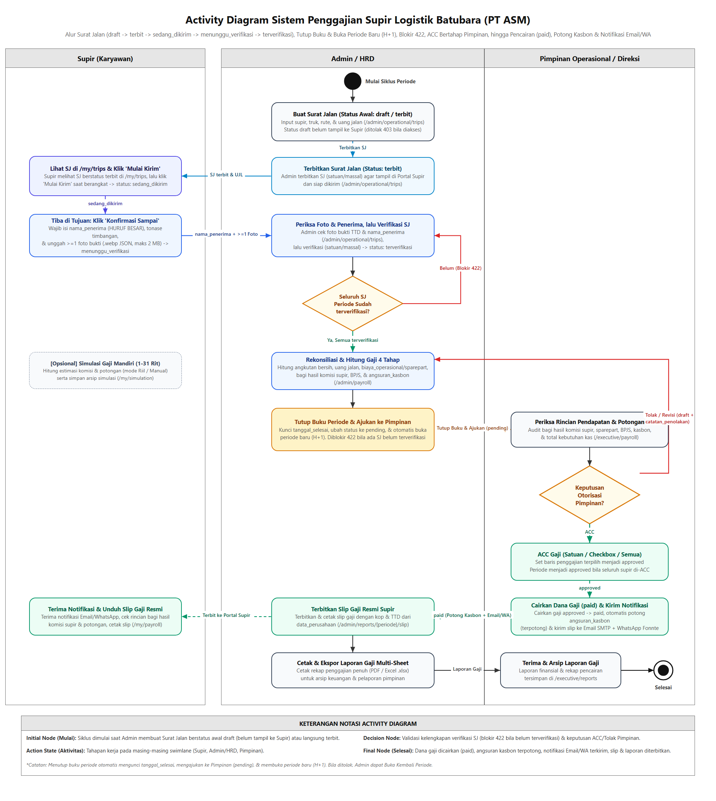
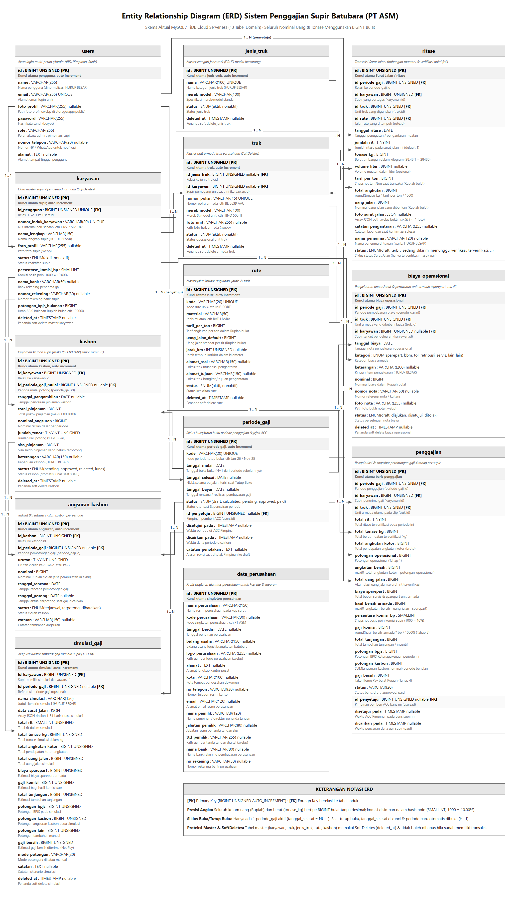

# Sistem Penggajian Supir Logistik Batubara (Payroll ASM)

> 🎓 **INFORMASI PROYEK TUGAS AKHIR / SKRIPSI:**  
> **Aplikasi ini dirancang dan dibangun sebagai proyek penelitian Tugas Akhir / Skripsi** di bidang Rekayasa Perangkat Lunak / Sistem Informasi.  
> Seluruh data yang tersaji di dalam basis data sistem—termasuk nama pengemudi, nomor induk karyawan (NIP), nomor registrasi polisi armada truk, rute jalur tambang, nominal transaksi ritase, jadwal angsuran kasbon, serta foto bukti fisik surat jalan—merupakan **DATA SIMULASI / MANIPULASI (DUMMY DATA)** yang digunakan untuk kebutuhan demonstrasi, pengujian skenario fungsional, dan validasi matematis algoritma penggajian. Sistem ini **tidak memuat data rahasia maupun data operasional riil dari perusahaan komersial manapun**.

---

## 1. Deskripsi & Tujuan Aplikasi

Dalam industri logistik transportasi batubara (_coal haulage_), penggajian pengemudi truk tronton tidak menggunakan sistem gaji bulanan statis (_fixed monthly salary_), melainkan berbasis pada **kinerja operasional harian di lapangan (ritase, tonase muatan, rute jalan, dan beban perawatan armada)**.

Tujuan utama dari pengembangan sistem ini adalah **menghadirkan standarisasi dan otomatisasi alur penggajian berbasis kejadian (event-driven operational lifecycle)** yang dimulai sejak **Surat Jalan pertama kali diterbitkan di pos operasional hingga pencairan dana disahkan oleh Direksi**.

Sistem ini memecahkan berbagai risiko bisnis nyata, seperti:

- Mencegah timbulnya surat jalan fiktif melalui validasi foto bukti fisik bertanda tangan penerima dan normalisasi data timbangan.
- Menjamin tidak ada surat jalan yang tertinggal (_unverified trips_) saat buku periode ditutup dan diajukan ke Direksi melalui mekanisme blokir otomatis (_strict pre-condition check_).
- Menghilangkan perselisihan pembagian komisi supir melalui rekonsiliasi berjenjang 4 tahap berpresisi bilangan bulat Rupiah (`BIGINT`).
- Mengotomatiskan pemotongan angsuran kasbon supir tepat pada saat pencairan dana gaji dieksekusi oleh Pimpinan, disertai pengiriman notifikasi slip gaji via Email & WhatsApp.
- Memberikan transparansi kepada pengemudi melalui **Portal Mandiri Supir** dan fitur **Simulasi & Kalkulator Gaji (1 s.d. 31 Rit)**.

---

## 2. Arsitektur & Spesifikasi Teknis (Tech Stack)

| Lapisan | Teknologi & Konfigurasi Standar |
| :--- | :--- |
| **Backend Framework** | **Laravel 13.x** (PHP `^8.3`), Monolith Server-Side Rendered (SSR) |
| **Frontend & UI** | **Blade Components**, **Tailwind CSS v3.4**, **Alpine.js v3**, **Vite 7** |
| **Database Utama** | **TiDB Cloud Serverless (MySQL Compatible, Port `4000` + TLS/SSL)** / MySQL 8.0 |
| **Session & Cache** | `file` driver di disk lokal (`SESSION_DRIVER=file`, `CACHE_STORE=file`) untuk latensi rendah |
| **Penyimpanan Media** | Disk lokal `storage/app/public` (`storage:link`), kompresi otomatis gambar ke `.webp` (maks 2 MB) |
| **Integrasi Notifikasi** | SMTP Gmail (Email Slip Gaji) & **Fonnte API** (WhatsApp Gateway) |
| **CI/CD & Deployment** | **GitHub Actions** (`quality-gate` → `deploy-vps` via **Cloudflare Tunnel `cloudflared`**) ke **Nginx + PHP 8.3-FPM** (`https://nabela-payroll.web.id`) |

---

## 3. Diagram Alur Bisnis & Skema Basis Data (ERD)

### 3.1. Activity Diagram Alur Penggajian End-to-End


### 3.2. Entity Relationship Diagram (ERD Database)


---

## 4. Tahapan Alur Operasional Penggajian (Urutan Bernomor 1–10)

Seluruh proses di dalam aplikasi mengikuti urutan bernomor yang mengikat antar peran (_Admin HRD_, _Supir_, dan _Pimpinan/Direksi_):

1. **Pembuatan Surat Jalan (`draft` atau langsung `terbit`) — Admin HRD (`/admin/operational/trips`):**
    - Admin membuat Surat Jalan baru untuk penugasan supir, nomor polisi armada, rute koridor tambang, dan uang jalan operasional.
    - Status awal dapat disetel ke **`draft`** (_Draf / Belum Diterbitkan_) atau langsung **`terbit`** (_Terbit / Siap Dikirim Supir_).
    - **Kunci Keamanan:** Surat Jalan berstatus **`draft` TIDAK BOLEH terlihat di Portal Supir (`/my/trips`)** dan setiap aksi supir (`mulai-kirim` atau `konfirmasi`) atas Surat Jalan `draft` otomatis ditolak oleh server dengan HTTP `403`.

2. **Penerbitan Surat Jalan (`draft` → `terbit`) — Admin HRD (`/admin/operational/trips`):**
    - Admin menerbitkan Surat Jalan draf (satuan maupun massal) menjadi status **`terbit`** agar penugasan resmi muncul di gawai/portal supir (`/my/trips`).

3. **Mulai Pengantaran oleh Supir (`terbit` → `sedang_dikirim`) — Supir (`/my/trips`):**
    - Supir melihat Surat Jalan berstatus **`terbit`** di Portal Supir, lalu menekan tombol **"Mulai Kirim"** (`PATCH /my/trips/{trip}/mulai-kirim`) saat armada mulai bergerak mengangkut batubara.
    - Status Surat Jalan otomatis berubah menjadi **`sedang_dikirim`** (_Sedang Dikirim_).

4. **Konfirmasi Tiba di Tujuan & Bukti Fisik Timbangan (`sedang_dikirim` → `menunggu_verifikasi`) — Supir (`/my/trips`):**
    - Saat tiba di stockpile atau pelabuhan pembongkaran, supir menekan tombol **"Konfirmasi Sampai"**.
    - Supir **wajib** mengisi **`nama_penerima`** (otomatis dinormalisasi menjadi HURUF BESAR oleh model `Ritase`), tonase hasil timbangan jembatan, dan **wajib** mengunggah minimal 1 (`>= 1`) foto bukti surat jalan fisik yang telah dibubuhi tanda tangan/stempel penerima (`foto_surat_jalan`, berkas gambar otomatis dikonversi ke `.webp` dengan batas maks 2 MB per foto).
    - Status Surat Jalan berubah menjadi **`menunggu_verifikasi`** (_Menunggu Verifikasi Admin_).

5. **Verifikasi Surat Jalan Lapangan (`menunggu_verifikasi` → `terverifikasi`) — Admin HRD (`/admin/operational/trips`):**
    - Admin memeriksa keabsahan foto bukti fisik bertanda tangan, kesesuaian tonase muatan, dan identitas penerima (dapat diverifikasi satuan maupun massal).
    - Admin menandai Surat Jalan sebagai **`terverifikasi`** (_Berhasil Terkirim & Terverifikasi_). Hanya surat jalan dengan status `terverifikasi` yang sah untuk diperhitungkan dalam penggajian.

6. **Rekonsiliasi Penggajian, Tutup Buku Periode, & Blokir Pengajuan (`draft` → `pending`) — Admin HRD (`/admin/payroll`):**
    - Layanan `PayrollCalculationService::rekonsiliasiPeriode()` **hanya** menghitung surat jalan yang berstatus **`terverifikasi`**.
    - Siklus periode dikelola oleh `PeriodeGajiLifecycleService`: hanya ada **satu periode berjalan** (`tanggal_selesai = NULL`). Saat tanggal gajian tiba, Admin menekan **Tutup Buku & Ajukan ke Pimpinan** (`PATCH /admin/payroll/{period}/tutup-buku`) yang otomatis mengunci tanggal selesai periode berjalan, mengubah status ke **`pending`**, dan membuka periode berikutnya (`H+1`).
    - **Blokir Integritas:** Server **wajib memblokir dengan HTTP `422`** apabila masih ditemukan Surat Jalan pada periode tersebut yang berstatus `draft`, `terbit`, `sedang_dikirim`, atau `menunggu_verifikasi`.

7. **Audit & Otorisasi Bertahap Direksi — Pimpinan / Direksi (`/executive/payroll`):**
    - Pimpinan memeriksa kebutuhan likuiditas kas (_cash requirement_), total komisi pengemudi, rekap uang jalan, beban sparepart per unit armada, serta potongan kewajiban (BPJS dan kasbon).
    - Pimpinan berwenang memberikan **ACC Satuan** per supir, **ACC Baris Terpilih** via checkbox, atau **ACC Semua** (`approved`).
    - Jika ditemukan selisih atau anomali data, Pimpinan dapat mengembalikan periode ke status **`draft`** (_Tolak / Revisi_) disertai **`catatan_penolakan`** (Admin dapat menggunakan fitur **Buka Kembali Periode** bila perlu menambah surat jalan susulan).

8. **Pencairan Dana (`approved` → `paid`), Pemotongan Kasbon, & Notifikasi Otomatis — Pimpinan (`/executive/payroll`):**
    - Pimpinan mengeksekusi pencairan dana (`PATCH /executive/payroll/{period}/disburse`) untuk baris gaji berstatus `approved` menjadi **`paid`** (_Sudah Dicairkan_).
    - Proses pencairan otomatis menandai jadwal tagihan `angsuran_kasbon` periode berjalan menjadi **`terpotong`**, mengurangi saldo `kasbon.sisa_pinjaman` (otomatis berstatus **`lunas`** saat sisa mencapai `0`), serta mengirimkan notifikasi slip gaji ke Email dan WhatsApp supir.

9. **Penerbitan Slip Gaji, Impor/Ekspor Excel Multi-Sheet, & Laporan Resmi (`data_perusahaan`):**
    - Slip gaji dan laporan keuangan periode hanya diterbitkan dan dapat diunduh setelah periode disetujui (`approved` / `paid`).
    - Tersedia fitur ekspor & impor migrasi Excel multi-sheet (`.xlsx`) dengan staging pratinjau dan deteksi anomali di `/admin/reports`.
    - Identitas legal perusahaan (kop surat, logo, nomor rekening bank pencairan, nama & tanda tangan pemilik) dikelola secara terpusat oleh Pimpinan di `/executive/company` pada tabel `data_perusahaan`.

10. **Simulasi Mandiri & Perencanaan Ritase Supir — Supir (`/my/simulation`):**
    - Supir dapat membuat proyeksi penghasilan mandiri dengan menyusun 1 s.d. 31 baris surat jalan simulasi berdasarkan rute-rute resmi aktif.
    - Supir dapat memilih mode potongan: **Data Riil Sistem** (otomatis menarik beban sparepart unit armadanya, potongan BPJS, dan cicilan kasbon bulan berjalan) atau **Input Manual Sendiri**.
    - Hasil simulasi dapat disimpan ke arsip akun supir pada tabel `simulasi_gaji`.

---

## 5. Rumus Kalkulasi Gaji Supir 4 Tahap

Seluruh perhitungan matematis dikonsolidasikan pada satu kelas layanan tunggal: `App\Services\PayrollCalculationService::hitungKomponenGaji()`.  
Semua nilai nominal uang menggunakan bilangan bulat Rupiah (`BIGINT`) untuk mencegah galat pembulatan desimal (_floating-point rounding errors_), berat muatan dalam kilogram (`tonase_kg BIGINT`), dan persentase komisi supir disimpan sebagai basis poin (`persentase_komisi_bp SMALLINT`, di mana `1000` = `10,00%`).

```text
Ritase Terverifikasi (tonase_kg × tarif_per_ton)
  └─► Total Angkutan Kotor (Bruto)
        └─ (-) Potongan Operasional
              └─► Angkutan Bersih (Pendapatan Bersih Angkutan)
                    └─ (-) Total Uang Jalan
                    └─ (-) Biaya Sparepart Armada (Biaya Unit Supir)
                          └─► Hasil Bersih Armada
                                └─ (×) Basis Poin Komisi / 10.000 (Dibulatkan ke Rupiah)
                                      └─► Gaji Komisi Supir
                                            └─ (+) Total Tunjangan Tetap / Bonus
                                            └─ (-) Potongan BPJS Ketenagakerjaan
                                            └─ (-) Potongan Kasbon (Jadwal Angsuran Berjalan)
                                            └─ (-) Potongan Historis Lain
                                                  └─► GAJI BERSIH (Take-Home Pay Diterima Supir)
```

1. **Tahap 1 — Pendapatan Angkutan Bersih:**  
   `angkutan_bersih = max(0, total_angkutan_kotor - potongan_operasional)`
2. **Tahap 2 — Hasil Bersih Armada:**  
   `hasil_bersih_armada = max(0, angkutan_bersih - total_uang_jalan - biaya_sparepart)`
3. **Tahap 3 — Hak Komisi Supir:**  
   `gaji_komisi = (int) round(($hasil_bersih_armada * $persentase_komisi_bp) / 10000)`
4. **Tahap 4 — Gaji Bersih / Take-Home Pay Supir:**  
   `gaji_bersih = max(0, gaji_komisi + total_tunjangan - potongan_bpjs - potongan_kasbon - potongan_historis_lain)`

---

## 6. Matriks Peran & Hak Akses Pengguna (Role-Based Access Control)

| Peran | Prefix URL | Hak Akses & Tanggung Jawab Operasional |
| :--- | :--- | :--- |
| **Admin HRD** (`admin`) | `/admin/*` | Pengelolaan data master (supir, armada truk + jenis truk, rute), penerbitan & verifikasi surat jalan lapangan, pencatatan biaya operasional & kasbon cicilan, rekonsiliasi payroll, tutup buku & pengajuan ke Pimpinan. **Dilarang keras menyetujui / memberi ACC.** |
| **Pimpinan / Direksi** (`pimpinan`) | `/executive/*` | Pemegang otoritas tertinggi pengesahan gaji: ACC satuan per supir, ACC batch/massal, penolakan/revisi periode ke draf, eksekusi pencairan dana gaji (`disburse`), pemantauan analitik eksekutif, serta tata kelola profil legal perusahaan (`/executive/company`). |
| **Pengemudi / Supir** (`supir`) | `/my/*` | Portal mandiri supir: menerima surat jalan terbit, tombol mulai kirim, konfirmasi serah terima muatan & unggah bukti foto fisik, pemantauan buku kasbon & jadwal cicilan, kalkulator simulasi gaji (1–31 rit), serta unduh slip gaji resmi. |

---

## 7. Panduan Menjalankan Proyek di Lingkungan Lokal (CMD Windows)

```cmd
:: 1. Clone repositori & masuk ke direktori proyek
git clone git@github.com:rzkyfhrzi21/app-payroll-asm.git
cd app-payroll-asm

:: 2. Pasang dependensi PHP dan Node.js
composer install
npm install

:: 3. Salin konfigurasi environment & buat kunci enkripsi aplikasi
copy .env.example .env
php artisan key:generate

:: 4. Sesuaikan kredensial DB di .env (TiDB Cloud Serverless port 4000 atau MySQL lokal)
::    Lalu jalankan migrasi, seeder data contoh, dan symlink storage publik
php artisan migrate --seed
php artisan storage:link

:: 5. Kompilasi aset frontend (Vite + Tailwind CSS)
npm run build

:: 6. Jalankan server pengembangan lokal
php artisan serve --port=8888
```

Setelah server aktif, akses aplikasi melalui peramban web di: `http://127.0.0.1:8888`

### Akun Uji Coba Default (Kredensial Simulasi):

- **Akun Admin Pengembang (Author `.env`):** `septiaranabila559@gmail.com` (atau sesuai `AUTHOR_EMAIL`) | Kata Sandi: `password`
- **Akun Admin HRD:** `admin@payroll.test` | Kata Sandi: `password`
- **Akun Pimpinan Direksi:** `pimpinan@payroll.test` | Kata Sandi: `password`
- **Akun Supir:** `supir@payroll.test` | Kata Sandi: `password`

---

## 8. Pengujian Otomatis & Endpoint Health Check

Aplikasi dilengkapi 222 pengujian otomatis (Unit & Feature Test) serta endpoint pemantauan kesehatan sistem:

```cmd
:: 1. Pastikan aset Vite sudah ter-build sebelum menjalankan PHPUnit
npm run build

:: 2. Jalankan seluruh suite pengujian otomatis (PHPUnit)
php artisan test

:: 3. Verifikasi kompilasi seluruh template Blade
php artisan view:clear
php artisan view:cache
```

- **Health Check Endpoint:** `GET /health` mengembalikan respons JSON `{"status":"ok"}` (HTTP `200`) tanpa autentikasi dan tanpa membocorkan detail konfigurasi internal.

---

## 9. Alur Branching & CI/CD Auto-Deploy ke VPS (`nabela-payroll.web.id`)

Repositori ini menggunakan pemisahan branch untuk pengembangan dan rilis produksi:

- **`master` (Development Branch):** Branch utama untuk pengerjaan fitur, perbaikan bug, dan sinkronisasi kode antar perangkat. Push ke `master` **tidak** memicu deployment ke server produksi.
- **`production` (Live Release Branch):** Branch khusus rilis produksi. Push ke `production` akan memicu workflow [`.github/workflows/deploy-vps.yml`](.github/workflows/deploy-vps.yml):
  1. **Job `quality-gate`:** Menjalankan `composer validate --strict`, instalasi dependensi, pemindaian kebocoran kredensial dengan **Gitleaks**, kompilasi aset frontend (`npm ci && npm run build`), pemeriksaan sintaks seluruh file PHP (`php -l`), dan eksekusi 222 pengujian otomatis (`php artisan test`).
  2. **Job `deploy-vps`:** Menginstal dependensi produksi (`composer install --no-dev --optimize-autoloader`), membangun aset Vite (`public/build/`), mengemas tarball (mengecualikan `.env*` dan `storage/*` agar file unggahan di server tetap aman), mengirim arsip melalui **Cloudflare Tunnel (`cloudflared`)** ke `/home/hatch/workspace/nabela-payroll.web.id/`, memperbarui cache konfigurasi/route/view, menjalankan `php artisan storage:link`, dan memverifikasi endpoint `GET /health`.

### Perintah Rilis ke Produksi:

```cmd
:: Push kode dari branch master ke branch production untuk memicu deploy otomatis
git push origin master:production
```

---

## 10. Identitas Peneliti / Pengembang & Konfigurasi `.env` (`AUTHOR_*`)

Identitas peneliti/pengembang dikelola melalui variabel environment `.env` (dibaca lewat `config('app.author')` di `config/app.php` dan dibagikan ke seluruh tampilan melalui `AppServiceProvider`). Apabila salah satu variabel `.env` dikosongkan atau tidak disetel, sistem secara otomatis menggunakan nilai bawaan (*fallback default*) berikut:

| Atribut | Variabel `.env` | Nilai Default (`config/app.php`) |
| :--- | :--- | :--- |
| **Nama Lengkap** | `AUTHOR_NAMA` | `Nabela Septiara` |
| **NPM** | `AUTHOR_NPM` | `2311050052` |
| **Username Instagram** | `AUTHOR_INSTAGRAM` | `nbelaasp_` |
| **Email Aktif** | `AUTHOR_EMAIL` | `septiaranabila559@gmail.com` |
| **Nomor WhatsApp** | `AUTHOR_WHATSAPP` | `085760898417` |
| **Judul Skripsi / Proyek** | `AUTHOR_JUDUL` | `Payroll System pada PT ASM Lampung` |
| **Dosen Pembimbing** | `AUTHOR_DOSBING` | `Bu Ayu Firdhayanti, S.Kom., M.T.I` |
| **Alamat** | `AUTHOR_ALAMAT` | `Kosan Dakwah` |

Data ini otomatis ditampilkan pada meta tag HTML, halaman login, footer portal (Admin, Supir, Pimpinan), modal **Tentang Pengembang**, serta footer dokumen cetak fisik (Slip Gaji, Rekapitulasi Periode, Surat Jalan, dan Buku Kasbon).
