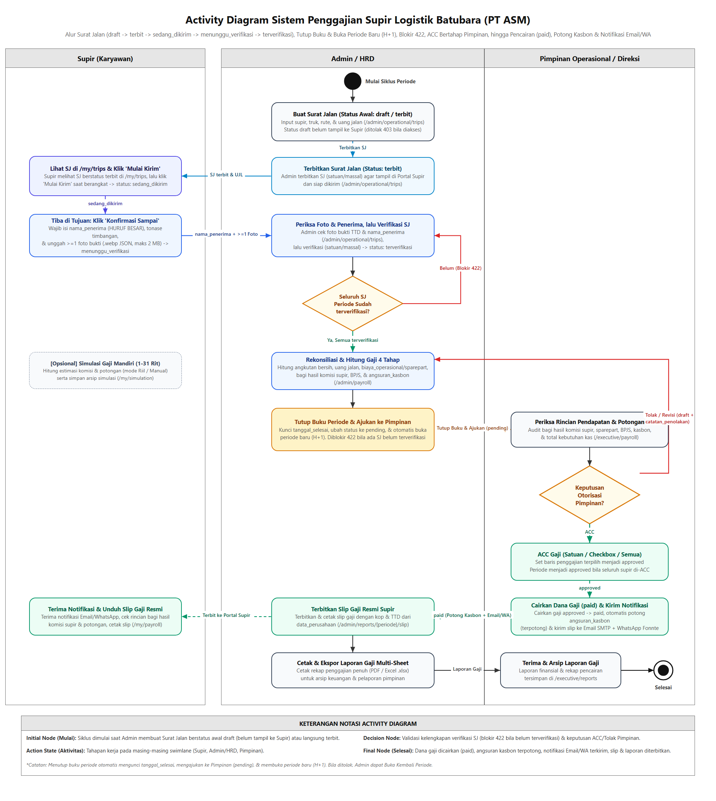

# Alur & Kode Inti Penggajian Supir

> 🎓 **INFORMASI PROYEK SKRIPSI & DATA SIMULASI:**  
> Dokumen ini merupakan dokumentasi teknis artefak penelitian **Tugas Akhir / Skripsi**. Seluruh data operasional, personal supir, armada, dan angka transaksi yang digunakan adalah **data simulasi / manipulasi akademik** yang dirancang untuk menguji keabsahan dan kepatuhan alur penggajian berbasis Surat Jalan operasional hingga pengesahan Direksi.

---

## 0. Diagram & Alur Bisnis End-to-End Terbaru



Ringkasan tahapan operasional dari pembuatan Surat Jalan hingga penerbitan slip gaji:

1. **Pembuatan Surat Jalan (`ritase.status = 'draft'` atau `'terbit'`) — Admin/HRD (`/admin/operational/trips`):**
   - Admin membuat Surat Jalan baru untuk supir beserta penugasan truk, rute, dan uang jalan dengan status default **`draft`** (`Draf (Belum Diterbitkan)`), atau dapat langsung menyetel **`terbit`**.
   - Surat Jalan berstatus **`draft` belum tampil di Portal Supir (`/my/trips`)** dan aksi supir atas SJ `draft` ditolak server (`403`).
2. **Penerbitan Surat Jalan (`draft` → `terbit`) — Admin/HRD (`/admin/operational/trips`):**
   - Admin menerbitkan Surat Jalan (satuan maupun massal) menjadi status **`terbit`** (`Terbit (Siap Dikirim Supir)`).
   - Hanya Surat Jalan berstatus **`terbit`** (dan tahap lanjutan) yang tampil di Portal Supir (`/my/trips`).
3. **Mulai Pengantaran & Konfirmasi Supir (`terbit` → `sedang_dikirim` → `menunggu_verifikasi`) — Supir (`/my/trips`):**
   - Supir melihat penugasan Surat Jalan berstatus **`terbit`** di `/my/trips`, lalu mengklik **"Mulai Kirim"** (`PATCH /my/trips/{ritase}/mulai-kirim`) saat mulai mengantar muatan sehingga status berubah menjadi **`sedang_dikirim`** (`Sedang Dikirim`).
   - Saat tiba di tujuan, supir mengonfirmasi pengantaran selesai lewat **"Konfirmasi Sampai"** di Portal Supir (dari status `terbit`, `sedang_dikirim`, maupun memperbarui `menunggu_verifikasi`).
   - Supir **wajib** mengisi **`nama_penerima`** (`VARCHAR(120)`, otomatis dinormalisasi HURUF BESAR), tonase timbangan, dan **wajib** mengunggah **`foto_surat_jalan`** (`JSON` array, mendukung `>= 1` foto bukti Surat Jalan TTD penerima & barang terkirim; masing-masing maks 2 MB dan otomatis dikonversi ke `.webp`) bila belum ada foto tersimpan.
   - Setelah dikonfirmasi supir, status berubah menjadi **`menunggu_verifikasi`** (`Menunggu Verifikasi Admin`).
4. **Verifikasi Admin (`menunggu_verifikasi` → `terverifikasi`) — Admin/HRD (`/admin/operational/trips`):**
   - Admin memeriksa kesesuaian foto Surat Jalan bertanda tangan, `nama_penerima`, dan catatan pengantaran (satuan maupun massal), lalu menandainya sebagai **`terverifikasi`** (`Berhasil Terkirim & Terverifikasi`).
5. **Rekonsiliasi & Pengajuan Payroll (`draft` → `pending`) — Admin/HRD (`/admin/payroll`):**
   - `PayrollCalculationService::rekonsiliasiPeriode()` **hanya** menghitung ritase yang berstatus **`terverifikasi`**.
   - Ketika Admin mengajukan periode ke Pimpinan (`POST /admin/payroll/{period}/submit`), server **memblokir pengajuan (HTTP 422)** apabila masih terdapat Surat Jalan pada periode tersebut yang berstatus **`draft`**, **`terbit`**, **`sedang_dikirim`**, atau **`menunggu_verifikasi`**.
6. **Audit, ACC Bertahap, & Penolakan Pimpinan — Pimpinan (`/executive/payroll`):**
   - Pimpinan memeriksa rincian pendapatan (omzet, uang jalan, komisi supir, tunjangan) dan potongan (sparepart, BPJS, kasbon) per supir.
   - Jika tidak sesuai, Pimpinan dapat melakukan **Tolak/Revisi** sehingga periode kembali ke `draft` disertai **`periode_gaji.catatan_penolakan`**.
   - Pimpinan dapat memberikan **ACC satuan** per supir (`PATCH /executive/payroll/{period}/approve` dengan `id_penggajian`), **ACC baris terpilih lewat checkbox** (`POST /executive/payroll/{period}/approve-batch` dengan `ids`), atau **ACC Semua** (`approved`), yang mencatat `id_penyetuju` dan `disetujui_pada` pada `penggajian` (dan pada `periode_gaji` ketika seluruh supir telah di-ACC).
7. **Pencairan Dana (`approved` → `paid`) — Pimpinan (`/executive/payroll`):**
   - Pimpinan mengeksekusi pencairan dana (`PATCH /executive/payroll/{period}/disburse`) untuk baris `penggajian` berstatus `approved`, mengubah statusnya menjadi **`paid`** (`Sudah Dicairkan`) dan mengisi `dicairkan_pada`.
   - Saat pencairan dilakukan, sistem otomatis memotong **`angsuran_kasbon`** periode berjalan menjadi **`terpotong`** dan mengurangi **`kasbon.sisa_pinjaman`** (menjadi **`lunas`** bila sisa `0`).
8. **Penerbitan Slip Gaji & Laporan dengan Profil Perusahaan (`data_perusahaan`):**
   - Pimpinan mengelola identitas tunggal perusahaan pada tabel **`data_perusahaan`** (`/executive/company`: nama perusahaan, kode, logo, alamat, kota, telepon, email, nama & jabatan pemilik, TTD digital pemilik, bank, dan nomor rekening).
   - Data tersebut otomatis tampil pada kop surat dan blok tanda tangan pengesahan di Slip Gaji & Laporan Cetak (`/admin/reports`, `/executive/reports`, dan `/my/payroll`).

---

## 1. Ringkasan Rumus Bertahap (Single Source of Truth)

Seluruh perhitungan angka gaji terpusat di `PayrollCalculationService::hitungKomponenGaji()` dengan ketentuan presisi berikut:
- Nilai mata uang disimpan sebagai bilangan bulat Rupiah (`BIGINT`), berat sebagai `tonase_kg` (`BIGINT`), volume sebagai `volume_liter` (`BIGINT`), dan komisi sebagai basis poin `persentase_komisi_bp` (`SMALLINT`, default `1000` = `10,00%`).
- Setiap tahap menjaga hasil minimum `0` (`max(0, ...)`) agar tidak bernilai negatif.

Alur perhitungan bertahap dari ritase harian sampai gaji bersih supir:

```text
Ritase Aktif (tonase_kg × tarif_per_ton)
  └─► total_angkutan_kotor (Bruto)
        └─ (-) potongan_operasional
              └─► angkutan_bersih (Pendapatan)
                    └─ (-) total_uang_jalan
                    └─ (-) biaya_sparepart
                          └─► hasil_bersih_armada
                                └─ (×) persentase_komisi_bp / 10.000 (dibulatkan ke Rupiah terdekat)
                                      └─► gaji_komisi (Gaji Komisi Supir)
                                            └─ (+) total_tunjangan
                                            └─ (-) potongan_bpjs
                                            └─ (-) potongan_kasbon
                                            └─ (-) potongan_historis_lain (saat rekonsiliasi slip historis)
                                                  └─► gaji_bersih (Net Pay diterima supir)
```

### Rincian 4 Tahap Rumus
1. **Tahap 1 — Omzet Bruto ke Pendapatan (`angkutan_bersih`):**
   - `total_angkutan_kotor`: akumulasi `ritase.total_angkutan` (`tonase_kg × tarif_per_ton` per pengiriman).
   - `angkutan_bersih = max(0, total_angkutan_kotor - potongan_operasional)`
2. **Tahap 2 — Beban Armada ke Hasil Bersih Armada (`hasil_bersih_armada`):**
   - `hasil_bersih_armada = max(0, angkutan_bersih - total_uang_jalan - biaya_sparepart)`
3. **Tahap 3 — Hak Komisi Supir (`gaji_komisi`):**
   - `gaji_komisi = (int) round(($hasil_bersih_armada * $persentase_komisi_bp) / 10000)`
   - Default `persentase_komisi_bp` adalah `1000` (10%).
4. **Tahap 4 — Gaji Bersih Diterima Supir (`gaji_bersih`):**
   - `gaji_bersih = max(0, gaji_komisi + total_tunjangan - potongan_bpjs - potongan_kasbon - potongan_historis_lain)`
   - **Penjelasan `$selisihHistoris` (`potongan_historis_lain`):** Pada `rekonsiliasiPeriode()` dan `perbaruiKomponenSupir()`, apabila baris `penggajian` sudah ada (misalnya dari seeder slip historis atau impor Excel yang memiliki penyesuaian historis di luar kolom BPJS dan kasbon), selisih antara rumus murni dan `gaji_bersih` yang tercatat dipertahankan sebagai `potongan_historis_lain` agar nominal historis tidak berubah sepihak saat dihitung ulang.

---

## 2. Peta File Inti Alur Penggajian

| File | Peran & Method Utama |
|---|---|
| `app-payroll-asm/app/Services/PayrollCalculationService.php` | **Mesin Kalkulasi & Persetujuan Inti.**<br>- `hitungKomponenGaji()`: rumus tunggal 4 tahap.<br>- `rekonsiliasiPeriode()`: membentuk baris `penggajian` dari `ritase` atau menghitung ulang baris yang sudah ada dalam `DB::transaction()`.<br>- `perbaruiKomponenSupir()`: memperbarui komponen (`biaya_sparepart`, `total_tunjangan`, `potongan_bpjs`) dan menghitung ulang turunan.<br>- `prosesPersetujuanPeriode()`: memproses ACC (`approved`) atau pengembalian ke `draft`.<br>- `hitungPotonganKasbonPeriode()` & `hitungSparepartTrukPeriode()`: mengambil agregasi sumber data kasbon & sparepart. |
| `app-payroll-asm/app/Http/Controllers/Admin/PayrollController.php` | **Controller Payroll Admin (`/admin/payroll`).**<br>- `index()`: menampilkan daftar supir & ringkasan periode.<br>- `calculate()`: `POST /admin/payroll/{period}/calculate` -> memanggil `rekonsiliasiPeriode()`.<br>- `submit()`: `PATCH /admin/payroll/{period}/submit` -> mengubah status ke `pending`.<br>- `approval()`: `POST /admin/payroll/{period}/approval` -> divalidasi `SubmitPayrollApprovalRequest` (hanya menerima `mode = 'reject'`) untuk menarik pengajuan ke `draft`.<br>- `updateDriver()` & `destroyDriver()`: edit komponen via drawer atau hapus baris gaji yang belum terkunci/tanpa ritase aktif. |
| `app-payroll-asm/app/Http/Controllers/Executive/PayrollReviewController.php` | **Controller Otorisasi Pimpinan (`/executive/payroll`).**<br>- `index()` & `show()`: pemilih periode dan lembar audit Pimpinan.<br>- `approve()` (`PATCH /executive/payroll/{period}/approve`) & `approveBatch()` (`POST /executive/payroll/{period}/approve-batch`): memanggil `prosesPersetujuanPeriode(..., 'approve')`.<br>- `reject()` (`PATCH /executive/payroll/{period}/reject`): memanggil `prosesPersetujuanPeriode(..., 'reject')` dengan catatan revisi. |
| `app-payroll-asm/app/Services/PayrollDataService.php` | **Query & Pemetaan Data Tampilan Payroll.**<br>- Admin: `formatPeriode()`, `ringkasanPayroll()`, `barisPayroll()`, `barisPayrollTerpaginasi()`.<br>- Pimpinan: `ringkasanEksekutif()`, `barisReviewPayrollEksekutif()`, `permintaanAccPimpinan()`, `ringkasanSemuaPeriodeEksekutif()`, `riwayatPermintaanAcc()`.<br>- Portal Supir & Laporan: `payrollSupir()`, `ritaseSupir()`, `kasbonSupir()`, `rincianLaporanPeriode()`. |
| `app-payroll-asm/app/Services/ExcelPayrollMigrationService.php` | **Impor & Ekspor Rekap Slip Excel (`RINCIAN GAJI SUPIR`).**<br>- `imporBerkasMigrasi()`: membaca file `.csv`/`.xlsx`, menyimpan `periode_gaji`, `ritase`, dan `penggajian`. Nilai sel rekap Excel historis (`> 0`) tetap diprioritaskan; apabila kolom hasil kosong (`0`), perhitungan fallback memanggil `PayrollCalculationService::hitungKomponenGaji()`.<br>- `eksporFormatMigrasi()`, `unduhTemplateKosong()`, `unduhBerkasDummyMigrasi()`: ekspor & template CSV. |
| `app-payroll-asm/resources/views/admin/payroll/index.blade.php` | **Antarmuka Payroll Bulanan Admin.** Menampilkan banner periode, kartu ringkasan, tabel supir, aksi *Hitung Gaji*, *Import/Export Excel*, drawer rincian komponen supir, dan pengajuan ke Pimpinan (tanpa tombol ACC). |
| `app-payroll-asm/resources/views/executive/payroll/index.blade.php` | **Antarmuka Audit & Otorisasi Pimpinan.** Tahap pilih periode, ringkasan kas payroll, tabel review supir, drawer rincian pendapatan & potongan, serta tombol ACC / Tolak Revisi. |

### Pemanggil Pendukung Lainnya
- `app-payroll-asm/app/Http/Controllers/Admin/Operational/EmployeeFinanceController.php`: `storeBpjs()`, `storeBpjsMassal()`, dan `storeAllowance()` menyinkronkan perubahan BPJS/tunjangan ke baris `penggajian` periode aktif lewat `PayrollCalculationService::perbaruiKomponenSupir()`.
- `app-payroll-asm/app/Http/Controllers/Driver/TripHistoryController.php`: `konfirmasi()` memperbarui tonase ritase supir lalu menyinkronkan total tonase, omzet kotor, dan komponen turunan lewat `PayrollCalculationService::perbaruiKomponenSupir()`.

---

## 3. Alur Status Periode, Penggajian, & Otorisasi

Siklus tanggal `periode_gaji` selalu berlangsung satu bulan penuh (tanggal 1 s/d hari terakhir bulan yang sama), dinormalkan otomatis pada event `saving` model `PeriodeGaji` melalui `App\Support\SiklusPeriodeGaji`.

Status yang tersedia:
- `ritase.status`: `draft`, `terbit`, `sedang_dikirim`, `menunggu_verifikasi`, `terverifikasi`, `dibatalkan`.
- `periode_gaji.status`: `draft`, `calculated`, `pending`, `approved`, `paid` (dilengkapi `id_penyetuju`, `disetujui_pada`, `dicairkan_pada`, `catatan_penolakan`).
- `penggajian.status`: `draft` (*Menunggu ACC*), `approved` (*Disetujui (Siap Cair)*), `paid` (*Sudah Dicairkan*) (dilengkapi `id_penyetuju`, `disetujui_pada`, `dicairkan_pada`).

```text
  Surat Jalan: [draft] ──(Admin: terbitkan)──► [terbit] ──(Supir: Mulai Kirim)──► [sedang_dikirim] ──(Supir: nama_penerima + foto TTD)──► [menunggu_verifikasi] ──(Admin: cek foto)──► [terverifikasi]
                                                                                                                                                                                                  │
  Periode:     [draft] ◄──(Pimpinan: reject + catatan_penolakan / Admin: tarik)────────────────────────────────────────────────────────────────────── [pending] ◄──(Admin: submit, wajib semua SJ terverifikasi)
                                                                                                                                                         │
                                                                                                              [paid] ◄──(Pimpinan: disburse + potong kasbon)── [approved] ◄──(Pimpinan: ACC satuan/checkbox/semua)
```

Aturan pemisahan kewenangan:
1. **Supir (`role:supir`)**:
   - Hanya melihat Surat Jalan yang sudah diterbitkan (`terbit`, `sedang_dikirim`, `menunggu_verifikasi`, `terverifikasi`, `dibatalkan`); SJ `draft` disembunyikan dari `/my/trips` dan ditolak `403` bila diakses aksinya.
   - Memulai pengantaran Surat Jalan di `/my/trips` (`terbit` → `sedang_dikirim`) lalu mengonfirmasi pengantaran selesai dengan wajib mengisi `nama_penerima` dan mengunggah `>= 1` foto Surat Jalan bertanda tangan penerima (`terbit` / `sedang_dikirim` → `menunggu_verifikasi`).
2. **Admin/HRD (`role:admin`)**:
   - Membuat Surat Jalan (`draft` / langsung `terbit`) dan menerbitkan SJ `draft` → `terbit` (satuan atau massal).
   - Memverifikasi bukti foto & penerima Surat Jalan (`menunggu_verifikasi` → `terverifikasi`).
   - Menjalankan `rekonsiliasiPeriode()` (hanya menghitung ritase `terverifikasi`) dan memperbarui komponen supir saat periode berstatus `draft`.
   - Mengajukan periode ke Pimpinan (`draft` → `pending`) lewat `Admin\PayrollController::submit` (diblokir 422 bila masih ada SJ `draft`, `terbit`, `sedang_dikirim`, atau `menunggu_verifikasi`).
   - **Dilarang memberikan ACC.** Endpoint `POST /admin/payroll/{period}/approval` hanya menerima `mode = 'reject'` (divalidasi oleh `SubmitPayrollApprovalRequest`) untuk menarik pengajuan kembali ke `draft`.
3. **Pimpinan (`role:pimpinan`)**:
   - Memeriksa kas yang dibutuhkan (*cash requirement*), komisi supir, potongan sparepart, BPJS, dan kasbon di `/executive/payroll`.
   - Memberikan keputusan **ACC** secara satuan per supir, via checkbox terpilih, maupun ACC Semua (`approved`), atau **Tolak/Revisi** (`pending` → `draft` disertai `catatan_penolakan`).
   - Mengeksekusi pencairan dana (`approved` → `paid`) yang sekaligus memotong `angsuran_kasbon` terkait.
   - Mengelola profil tunggal perusahaan pada tabel `data_perusahaan` melalui `/executive/company`.

---

## 4. Catatan Sumber Data Perhitungan

1. **`ritase`** (Rekam pengantaran harian):
   - Hanya ritase dengan `status = 'terverifikasi'` pada `id_periode_gaji` terkait yang diikutsertakan saat pembentukan/rekonsiliasi baris `penggajian` (`rekonsiliasiPeriode()`).
   - Menyuplai `total_rit` (`SUM(jumlah_rit)`), `total_tonase_kg` (`SUM(tonase_kg)`), `total_angkutan_kotor` (`SUM(total_angkutan)`), dan `total_uang_jalan` (`SUM(uang_jalan)`).
2. **`biaya_operasional`** (Beban sparepart armada):
   - Diambil oleh `PayrollCalculationService::hitungSparepartTrukPeriode()` khusus untuk `id_truk` terkait dengan syarat `kategori = 'sparepart'`, `status = 'disetujui'`, dan `tanggal_biaya` berada dalam rentang `[tanggal_mulai, tanggal_selesai]` periode.
3. **`angsuran_kasbon`** (Cicilan kasbon supir):
   - Sesuai aturan proyek (`AGENTS.md` 3.6), `penggajian.potongan_kasbon` **dilarang** diisi angka manual dan wajib berasal dari akumulasi tabel `angsuran_kasbon`.
   - `PayrollCalculationService::hitungPotonganKasbonPeriode()` menjumlahkan `angsuran_kasbon.nominal` dari kasbon milik `id_karyawan` yang berstatus `approved` atau `lunas`, baik yang sudah tertaut langsung lewat `id_periode_gaji` maupun yang `tanggal_rencana`-nya jatuh di rentang `[tanggal_mulai, tanggal_selesai]` periode (karena cicilan masa depan dapat bernilai `id_periode_gaji = NULL`).
   - Pada proses impor migrasi (`ExcelPayrollMigrationService::imporBerkasMigrasi()`), `potongan_kasbon` juga diambil langsung dari `SUM(angsuran_kasbon.nominal)` untuk `id_periode_gaji` dan `id_karyawan` terkait, bukan dari sel angka manual di file Excel.

<!-- CATATAN SEMENTARA: Fitur tunjangan (total_tunjangan) untuk sementara dihapus dari aplikasi (branch master). Versi lengkap dengan tunjangan tersimpan di branch v1. Isi dokumen ini belum diubah. -->
